# Task 6: Design Challenge: Campus Event Registration Desktop Application

**Layout:**
```
Task6/
├── sql/schema.sql                      tables, UNIQUE(reg_no, event_id), sample events
├── lib/mariadb-java-client-2.7.6.jar   JDBC driver (works with MySQL and MariaDB)
└── src/registration/
    ├── ui/       RegistrationApp (JFrame, JMenuBar, CardLayout screens, SwingWorkers), RegistrationDemo, Shot
    ├── service/  RegistrationService (validation, duplicate and capacity rules, CSV export)
    └── dao/      RegistrationDao (all SQL, PreparedStatement, try-with-resources)
```
**Run (MySQL):**
```bash
mysql -u root -p < sql/schema.sql                         # creates database campus + tables + 5 events
javac -cp lib/mariadb-java-client-2.7.6.jar -d out $(find src -name "*.java")
java -cp out:lib/mariadb-java-client-2.7.6.jar -Ddb.url=jdbc:mysql://localhost:3306/campus -Ddb.user=root -Ddb.password=YOUR_PASSWORD registration.ui.RegistrationApp
```
(On Windows use `;` instead of `:` in `-cp`. The default URL is `jdbc:mariadb://localhost:3306/campus` with user `student`/`student123`, the setup used for the recorded evidence.)
**Evidence:** `output/RegistrationDemo.txt`, `screenshots/`

## Stage 1: interpret the problem
- **Users:** students (registering, at a desk or self-service) and committee members (viewing, filtering, exporting).
- **Screens:** Register form; Registrations list (table + event filter + paging); dialogs (About, Save-as for export, error messages).
- **Data:** `events` (id, name, venue, date, capacity); `registrations` (id, reg_no, name, e-mail, department, event_id, registered_at).
- **Rules and testable requirements:**
  - R1: a register number must be exactly 9 digits, the name letters only, the e-mail valid, and an event chosen, otherwise a red message naming the field is shown and **nothing is saved**.
  - R2: the same register number **cannot be saved twice for the same event**. This is enforced by the service *and* by `UNIQUE(reg_no, event_id)`, so it holds even if two clerks submit at once.
  - R3: the same student **may** register for different events.
  - R4: no registration beyond an event's capacity.
  - R5: the window stays responsive while data loads: the EDT answers within **50 ms** during any database operation.
  - R6: filtering by event shows only that event's rows, with a count.
  - R7: export writes all matching rows (not just the visible page) to CSV.
  - R8: with 100,000 registrations, the list shows its first page in **< 1 s**, with bounded memory.

## Stage 2: screens and event flow
```
┌ JMenuBar: File(Export CSV  Ctrl+E | Exit)   View(Register Student | All Registrations)   Help(About) ┐
├─────────────────────────────── CardLayout ─────────────────────────────────────────────────────────┤
│ card "register"                              │ card "list"                                          │
│  Register number [_________]                 │  Filter by event: [All events ▼]  [Export CSV]        │
│  Student name    [_________]                 │  ┌ JTable (ID, Reg No, Name, E-mail, Dept, Event, At)┐ │
│  E-mail          [_________]                 │  │ … one page of 50 rows …                           │ │
│  Department      [CSE ▼]                     │  └───────────────────────────────────────────────────┘ │
│  Event           [Dance Battle ▼]            │  "Showing 1-50 of 100003"          [< Prev] [Next >]  │
│  [Register]      status (green / red)        │                                                       │
└──────────────────────────────────────────────┴───────────────────────────────────────────────────────┘
View ▸ Register Student ──▶ register card ── Register ──▶ (worker) ──▶ green "Registered…" | red error
View ▸ All Registrations ─▶ list card ── load page 0 (worker) ── Filter ▼ / Prev / Next ──▶ load page (worker)
File ▸ Export / [Export CSV] ─▶ JFileChooser (Save) ─▶ (worker) export ─▶ "Exported n registrations"
Help ▸ About ─▶ JOptionPane          File ▸ Exit ─▶ dispose()
```
Screenshots: `1_register_screen.png`, `5_all_registrations.png`, `6_filtered.png`, `9_paged_100k.png`.

## Stage 3: critical design decisions
| Concern | Where | How |
|---|---|---|
| Input validation | `RegistrationService.validate()`, called **first on the EDT** (fast, no I/O) and again inside `register()` | regex checks; the message names the field; no DB call when input is invalid |
| Duplicate check | **two levels**: `service.register()` asks `dao.exists()` for a friendly message; **`UNIQUE(reg_no, event_id)`** in the database is the real guarantee | if two clerks race, the second `INSERT` fails with SQLState 23000 → `DuplicateRegistrationException` → the same friendly message (verified: a direct duplicate INSERT was rejected) |
| Database access | only in `RegistrationDao`; `PreparedStatement` (no SQL injection), try-with-resources (no leaked connections) | the UI never sees SQL or JDBC types |
| Keeping the EDT free | every DB call (load events, register, load page, count, export) runs in a **`SwingWorker`** `doInBackground()`; results are applied in `done()` on the EDT | while saving, the Register button is disabled (no double submit); while loading, Prev/Next are disabled |

## Stage 4: classes and handlers

```mermaid
classDiagram
  direction LR
  class RegistrationApp { <<JFrame>> -RegistrationService service ; -CardLayout cards ; -DefaultTableModel model ; +onRegister() ; +loadPage() ; +onExport(Path) ; -menu() JMenuBar }
  class RegistrationService { +validate(regNo,name,email,dept,event) ; +register(...) long ; +page(filter,size,pageNo) List ; +count(filter) int ; +exportCsv(filter,Path) int }
  class RegistrationDao { +events() List~Event~ ; +exists(regNo,eventId) bool ; +countFor(eventId) int ; +insert(...) long ; +page(eventId,limit,offset) List~Registration~ ; +count(eventId) int }
  class Event { <<record>> id ; name ; venue ; date ; capacity }
  class Registration { <<record>> id ; regNo ; name ; email ; department ; event ; at }
  RegistrationApp --> RegistrationService : UI layer → service
  RegistrationService --> RegistrationDao : service → data access
  RegistrationDao ..> Event
  RegistrationDao ..> Registration
  RegistrationApp ..> SwingWorker : runs DB work
```

```
ALGORITHM RegisterAction                         // Register button, on the EDT
INPUT  : regNo, name, email, dept, event (from the form)
BEGIN
    TRY service.validate(regNo, name, email, dept, event)
    CATCH InvalidInput AS e: show e.message in red; RETURN               // no DB access
    disable Register; show "Saving..."
    START SwingWorker:
        doInBackground:  id ← service.register(...)      // exists? → capacity? → INSERT (UNIQUE key)
        done (EDT):      enable Register
                         IF success THEN show "Registered <regNo> for <event> (#id)" in green; clear the form
                         ELSE IF Duplicate / EventFull / InvalidInput THEN show its message in red
                         ELSE show "Database error - registration not saved: <cause>" in red
END

ALGORITHM FilterAction                           // filter combo changed (also Prev / Next with pageNo ± 1)
INPUT  : selected filter (All or an Event), pageNo, PAGE = 50
BEGIN
    pageNo ← 0;  disable Prev, Next;  show "Loading..."
    START SwingWorker:
        doInBackground:  total ← service.count(filter)
                         rows  ← service.page(filter, PAGE, pageNo)  // SQL: … WHERE event_id = ? ORDER BY id DESC LIMIT ? OFFSET ?
        done (EDT):      model.setRowCount(0); add each row
                         show "Showing a–b of total [for event]"
                         enable Prev IF pageNo > 0;  enable Next IF b < total
END
```

## Stage 5: implementation and demonstrated test cases
(from `output/RegistrationDemo.txt`, using the real window)
| Test | Input | Result |
|---|---|---|
| T1 normal | 192311001, Arun Kumar, Dance Battle | Registered 192311001 for Dance Battle (registration #1). |
| T2 normal, other event | same student, Battle of Bands | Registered … (#2): R3 holds |
| T3 normal, other student | 192311002, Dance Battle | Registered … (#3) |
| T4 invalid | register no `19231` | Register number must be exactly 9 digits. |
| T5 invalid | e-mail `kiran.simats.edu` | Enter a valid e-mail address, e.g. name@college.edu. |
| T6 invalid | no event chosen | Choose an event. |
| **T7 duplicate** | 192311001 + Dance Battle again | **192311001 is already registered for Dance Battle.** |
| DB-level duplicate | direct `INSERT` bypassing the service | rejected by `UNIQUE(reg_no, event_id)` |
| List / filter | All events / Dance Battle | Showing 1-3 of 3 / Showing 1-2 of 2 for Dance Battle |
| Export | filter = Dance Battle | Exported 2 registrations (CSV printed in the output) |

## Alternative concept: load everything vs one page at a time (100,000 registrations)
```java
// load all (naive): on the EDT
for (Registration r : dao.page(0, 1_000_000, 0)) model.addRow(...);      // SELECT … (no LIMIT)
// paged (implemented): in a SwingWorker
SELECT … ORDER BY r.id DESC LIMIT 50 OFFSET ?    → model holds 50 rows
```
**Measured with 100,003 rows:**
| | Load time | Rows in memory | Memory | EDT during load |
|---|---|---|---|---|
| A) load all, on the EDT | ≈ 608 ms (here; it grows linearly with rows and is much slower over a network) | 100,003 | **≈ 41 MB** | **blocked for the whole 608 ms**: window frozen |
| B) one page of 50, SwingWorker | ≈ 263 ms (count + page query) | 50 | ≈ 0.2 MB | worst response **11 ms**: fully responsive |

- **Time:** load-all is **O(N)** in transfer, object creation and table rows. A page is **O(P + OFFSET)**: the database still skips OFFSET rows (measured 166 ms at OFFSET 0 → 198 ms at OFFSET 99,950, plus the COUNT). Keyset paging (`WHERE id < lastSeenId ORDER BY id DESC LIMIT 50`) would make every page O(log N + P).
- **Memory:** load-all is **O(N)** (≈ 420 B per row: 7 objects per row plus the Vector structures in `DefaultTableModel`). Paging is **O(P)**, constant.
- **Responsiveness:** load-all on the EDT freezes the window in proportion to N. Load-all in a SwingWorker would avoid the freeze but still costs O(N) memory, a long wait before anything appears, and slow `JTable` sorting and filtering. Paging in a worker meets R5 and R8. Export still covers **all** rows, by streaming 1,000 at a time with constant memory.
